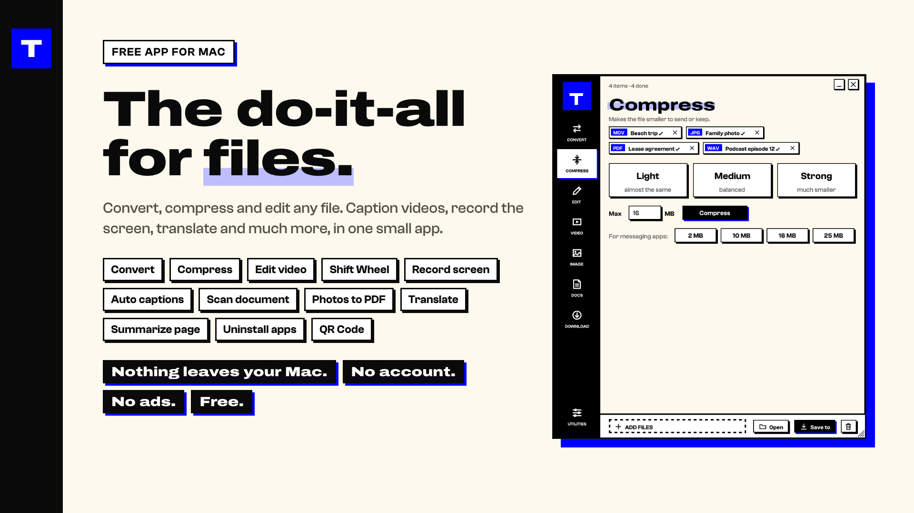
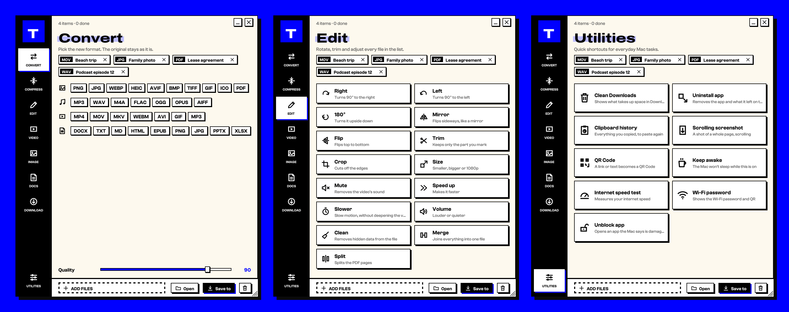
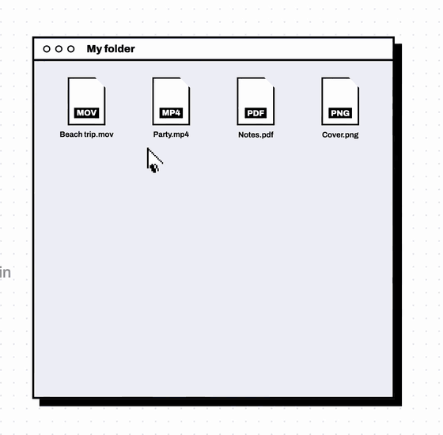

<p align="center">
  
</p>

<p align="center">
  <a href="README.md">Português</a> · <b>English</b>
</p>

<h3 align="center">
  <a href="https://github.com/movemontes/treco/releases/latest/download/Treco-mac.dmg">⬇️ Download for Mac</a>
</h3>

<p align="center">🌐 <a href="https://movemontes.github.io/treco/en/">movemontes.github.io/treco/en</a></p>

<p align="center">Free · No account · No ads · Nothing leaves your computer</p>

---

**Treco** is a small app for everyday file chores: convert, compress, trim videos, add captions, scan documents, record your screen, translate, summarize a web page… All in one place, with no sketchy websites and without sending your files anywhere.

## Why Treco

- **Nothing leaves your Mac.** Your files are processed on your own computer. No uploads.
- **No account, no sign-in.** Open it and use it.
- **No ads, no subscription.** Actually free.
- **One app instead of ten websites.** Convert, compress, edit and much more.
- **Shift wheel:** hold Shift while dragging a file in Finder and pick what to do, without even opening Treco.
- **Speaks English and Portuguese**, and updates itself.

<p align="center">
  
</p>

## What it does

| Video & audio | Images | Documents | Utilities |
|---|---|---|---|
| Convert (MP4, MOV, MP3, WAV…) | Convert (JPG, PNG, HEIC, WEBP…) | PDF ↔ Word, spreadsheets, presentations | Scrolling screenshot |
| Compress to the size you want | Compress | Merge and split PDFs | Clipboard history |
| Trim, crop, rotate, mirror | **Scan document** (a photo becomes a straight, clean PDF) | Add or remove a PDF password | Fully uninstall apps |
| Faster or **slower** without deepening the voice | **Photos to PDF** | **Translate** documents and subtitles | Clean the Downloads folder |
| Mute, adjust volume | **Slides to video** | **Summarize a page** with the Mac's own AI | QR codes and Wi-Fi password |
| **Caption videos** and transcribe speech | Remove background, read text, blur faces | Batch rename | Keep the Mac awake |
| Record voice, screen, or both | Watermark | | Internet speed test |

### Shift wheel

<p align="center">
  
</p>

Hold **Shift** and drag a file in Finder: the actions pop up around your cursor. Let go, done. The original is never moved or deleted.

## How to install

1. [**Download Treco**](https://github.com/movemontes/treco/releases/latest/download/Treco-mac.dmg) (`.dmg` file).
2. Open it and drag **Treco** into **Applications**.
3. Open Treco from Applications.
4. The first time, macOS says it can't verify the app. That's because it's free and not from the App Store. Open **System Settings → Privacy & Security**, scroll down and click **Open Anyway**. You only need to do this once.

**Requires:** a Mac with Apple silicon (M1 or newer) and macOS 13 or newer. Translate and Summarize page need macOS 26 (Summarize also needs Apple Intelligence turned on).

**Permissions macOS may ask for:**
- **Screen Recording:** to record the screen and for scrolling screenshots.
- **Microphone:** to record your voice.
- **Downloads folder:** for Clean Downloads.
- **Control Finder:** only when uninstalling App Store apps (Finder asks for your password).

The Shift wheel needs no permissions.

## Privacy

Treco has no account, collects no data and never sends your files anywhere. It only goes online when you ask (downloading a video, reading a page to summarize, testing your internet, downloading the captions model) and, once a day, to check here on GitHub for a new version.

## Support

Treco is and will stay free. I made it on my own and I've got 5 mouths to feed 😅. If it helped you, any amount means a lot.

<!-- donation link (USD) here -->

Donations are coming soon. In the meantime, a ⭐ on this repo helps a lot too.

Thank you so much! — Mateus

## For developers

Python (Tk) with PyObjC on macOS. Also runs on Windows from source.

```bash
python3 -m venv .venv
.venv/bin/pip install -r requirements.txt
sh vendor/build_ffmpeg.sh              # ffmpeg with subtitles and transcription
.venv/bin/python treco.py              # opens Treco (TRECO_LANG=en forces English)
.venv/bin/python vendor/build_mac.py   # builds dist/Treco.app and the .dmg
```

Translations live in `treco_app/core/en.json` (Portuguese text → English text).

## License

[MIT](LICENSE): free to use, copy and modify.
