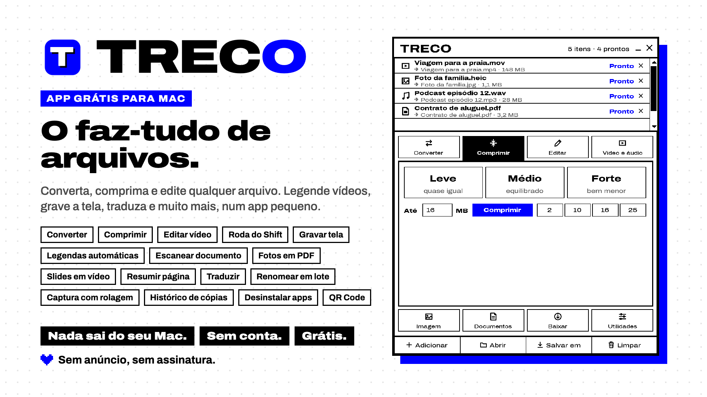
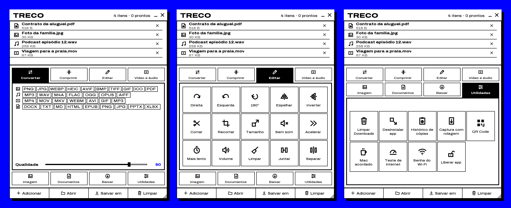
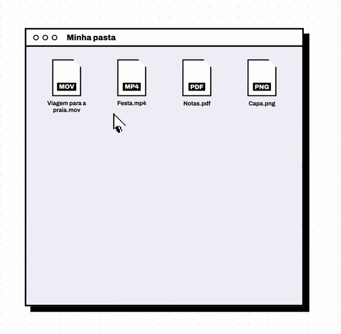

<p align="center">
  
</p>

<p align="center">
  <b>Português</b> · <a href="README.en.md">English</a>
</p>

<h3 align="center">
  <a href="https://github.com/movemontes/treco/releases/latest/download/Treco-mac.dmg">⬇️ Baixar para Mac</a>
</h3>

<p align="center">Grátis · Sem conta · Sem anúncio · Nada sai do seu computador</p>

---

**Treco** é um app pequeno que resolve o dia a dia com arquivos: converter, comprimir, cortar vídeo, legendar, escanear documento, gravar a tela, traduzir, resumir uma página… Tudo num lugar só, sem abrir site estranho e sem mandar seus arquivos para ninguém.

## Por que usar

- **Nada sai do seu Mac.** Seus arquivos são processados no próprio computador. Nenhum upload.
- **Sem conta e sem login.** Abriu, usou.
- **Sem anúncio e sem assinatura.** É grátis de verdade.
- **Um app só no lugar de dez sites.** Converter, comprimir, editar e muito mais.
- **Roda do Shift:** segure Shift enquanto arrasta um arquivo no Finder e escolha o que fazer, sem nem abrir o Treco.
- **Fala português e inglês**, e se atualiza sozinho.

<p align="center">
  
</p>

## O que ele faz

| Vídeo e áudio | Imagem | Documentos | Utilidades |
|---|---|---|---|
| Converter (MP4, MOV, MP3, WAV…) | Converter (JPG, PNG, HEIC, WEBP…) | PDF ↔ Word, planilhas, apresentações | Captura de tela com rolagem |
| Comprimir até o tamanho que você quer | Comprimir | Juntar e separar PDF | Histórico de cópias |
| Cortar, recortar, girar, espelhar | **Escanear documento** (foto vira PDF reto e limpo) | Pôr e tirar senha de PDF | Desinstalar apps por completo |
| Mais rápido ou **mais lento** sem engrossar a voz | **Fotos em PDF** | **Traduzir** documentos e legendas | Limpar a pasta Downloads |
| Tirar o som, ajustar o volume | **Slides em vídeo** | **Resumir página** com a IA do próprio Mac | QR Code e senha do Wi-Fi |
| **Legendar vídeo** e transcrever a fala | Tirar o fundo, ler texto, borrar rostos | Renomear em lote | Manter o Mac acordado |
| Gravar voz, tela, ou tela com voz | Marca d'água | | Teste de internet |

### Roda do Shift

<p align="center">
  
</p>

Segure **Shift** e arraste um arquivo no Finder: as ações aparecem em volta do cursor. Soltou, pronto. O original nunca é movido nem apagado.

## Como instalar

1. [**Baixe o Treco**](https://github.com/movemontes/treco/releases/latest/download/Treco-mac.dmg) (arquivo `.dmg`).
2. Abra o arquivo e arraste o **Treco** para a pasta **Aplicativos**.
3. Abra o Treco pelos Aplicativos.
4. Na primeira vez, o Mac avisa que não consegue verificar o app. Isso acontece porque ele é gratuito e não passou pela loja da Apple. Abra **Ajustes do Sistema → Privacidade e Segurança**, role até o fim e clique em **Abrir Mesmo Assim**. Só precisa fazer isso uma vez.

**Precisa de:** Mac com chip Apple (M1 ou mais novo) e macOS 13 ou mais novo. Traduzir e Resumir página precisam do macOS 26 (o Resumir também precisa da Apple Intelligence ligada).

**Permissões que o Mac pode pedir:**
- **Gravação de Tela:** para gravar a tela e para a captura com rolagem.
- **Microfone:** para gravar a voz.
- **Pasta Downloads:** para o Limpar Downloads.
- **Controlar o Finder:** só ao desinstalar apps da App Store (o Finder pede a sua senha).

A Roda do Shift não precisa de nenhuma permissão.

## Privacidade

O Treco não tem conta, não coleta dados e não envia seus arquivos para lugar nenhum. Ele só usa a internet quando você pede (baixar um vídeo, ler uma página para resumir, testar a internet, baixar o modelo de legendas) e, uma vez por dia, para ver se saiu uma versão nova aqui no GitHub.

## Apoie

O Treco é e vai continuar grátis. Fiz ele sozinho e tenho 5 bocas pra alimentar 😅. Se ele te ajudou, qualquer valor ajuda muito:

- **Pix** (chave aleatória, PicPay): `e2a1f4a9-ebfe-4c3c-a531-92a0e7433f14`

Obrigado de coração! — Mateus

## Para quem programa

Feito em Python (Tk) com PyObjC no Mac. Também roda no Windows a partir do código.

```bash
python3 -m venv .venv
.venv/bin/pip install -r requirements.txt
sh vendor/build_ffmpeg.sh              # ffmpeg com legendas e transcrição
.venv/bin/python treco.py              # abre o Treco (TRECO_LANG=en força inglês)
.venv/bin/python vendor/build_mac.py   # gera dist/Treco.app e o .dmg
```

Detalhes do Mac em [MAC_PORT.md](MAC_PORT.md). Traduções em `treco_app/core/en.json`.

## Licença

[MIT](LICENSE): pode usar, copiar e modificar à vontade.
